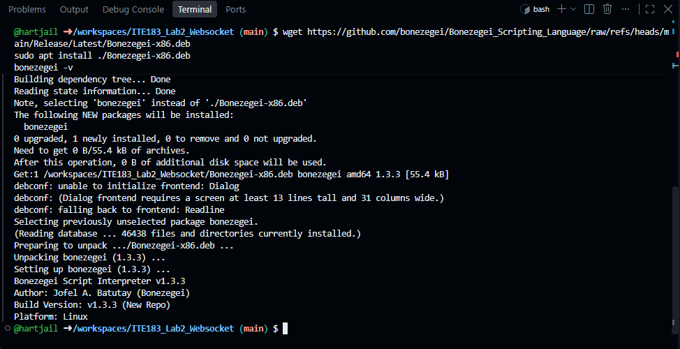
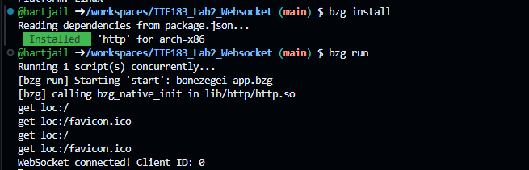
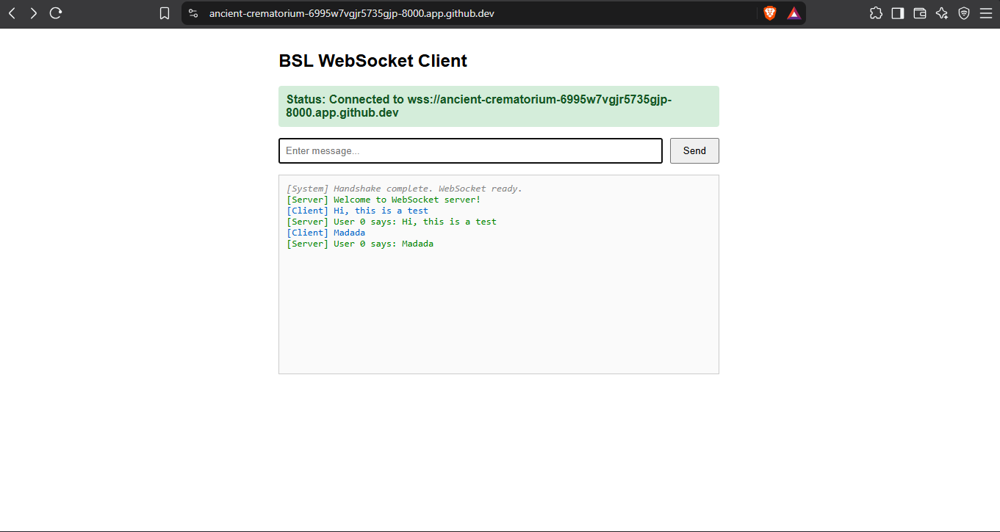

# ITE183_Lab2_Websocket

A real-time multi-client chat server built with the **Bonezegei Scripting Language (v1.3.3)**. It serves static web pages over HTTP and handles full-duplex communication over WebSocket, broadcasting each message to every connected client.

## Features

- HTTP server on port 8000 serving static files from `public/`
- Custom `404.html` page for undefined routes
- WebSocket connection lifecycle handling (connect, message, disconnect)
- Real-time broadcasting to all connected clients using `server.sendAll()`
- Browser chat client with live connection status

## Project Structure

```
ITE183_Lab2_Websocket/
├── .gitattributes
├── LICENSE
├── README.md
├── app.bzg          # HTTP + WebSocket server
├── package.json     # Project and dependency configuration
└── public/
    ├── index.html   # Multi-client chat interface
    └── 404.html     # Custom 404 page
```

## Requirements

- Bonezegei Scripting Language **v1.3.3**
- A modern web browser

### Installing Bonezegei (Linux / GitHub Codespaces)

```bash
wget https://github.com/bonezegei/Bonezegei_Scripting_Language/raw/refs/heads/main/Release/Latest/Bonezegei-x86.deb
sudo apt install ./Bonezegei-x86.deb
bonezegei -v
```

On Windows, install Bonezegei from the Microsoft Store.

## How to Run

```bash
git clone https://github.com/<your-username>/ITE183_Lab2_Websocket.git
cd ITE183_Lab2_Websocket
bzg install
bzg run
```

Then open `http://localhost:8000` in your browser. In GitHub Codespaces, open port 8000 from the **Ports** tab and set its visibility to **Public**.

## How to Test

1. Open the server address in two or more browser windows.
2. Send a message in one window. It appears in all windows as `User <id> says: <message>`.
3. Visit any unknown path (for example `/hello`) to see the custom 404 page.
4. Close a window and check the terminal for the disconnect log.

## Server Events

| Event | Behavior |
|---|---|
| `server.get` | Serves `public/index.html` for `/`, otherwise `public/404.html` |
| `server.onConnect` | Logs the client ID and sends a welcome message |
| `server.onData` | Logs the message and broadcasts it to all clients |
| `server.onDisconnect` | Logs the client ID of the disconnected client |

## Screenshots

### Version check


### Install and run


### Multi-client chat


### Custom 404 page
.png)

## License

This project is licensed under the MIT License. See the [LICENSE](LICENSE) file.
